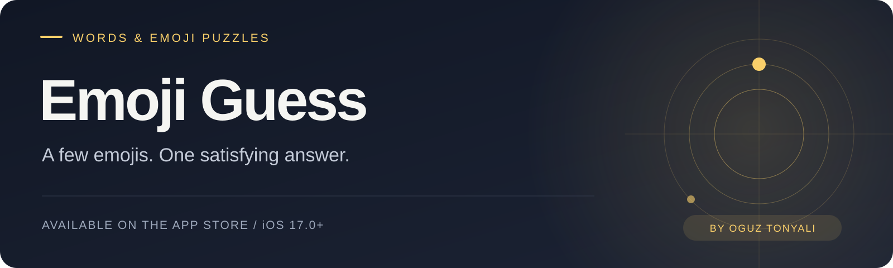
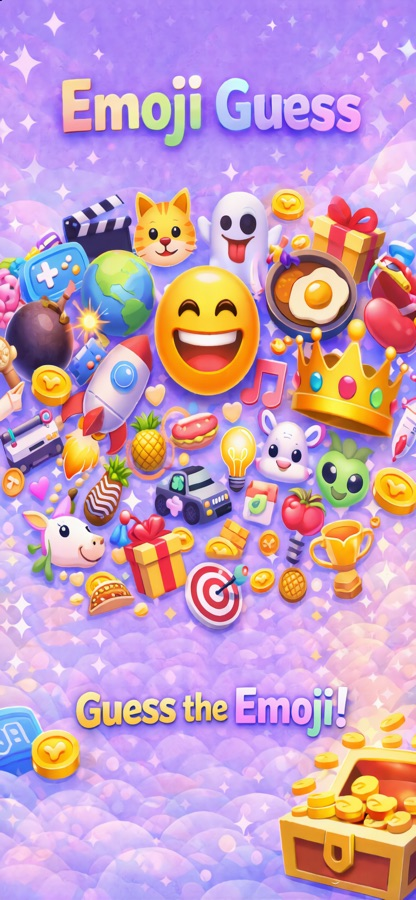
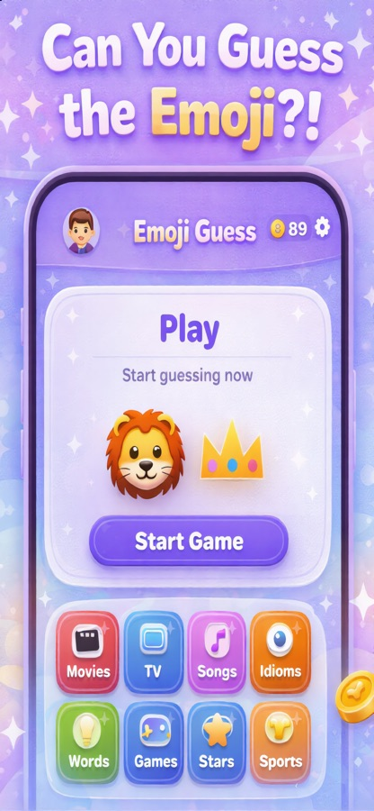
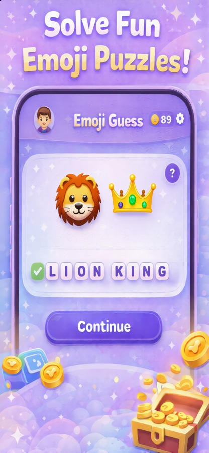

  <a href="https://apps.apple.com/us/app/emoji-guess-fun-emoji-puzzle/id6762650151"><strong>View on the App Store ↗</strong></a> &nbsp; · &nbsp;
  <a href="docs/ENGINEERING.md">Engineering notes</a> &nbsp; · &nbsp;
  <a href="https://github.com/Zodomik">More by Oğuz Tonyalı</a>

## Emoji Guess

A native word puzzle game about decoding emoji combinations. Movies, music, idioms and more become quick challenges with hints, rewards and daily progression.

Built and published by **[Oğuz Tonyalı](https://github.com/Zodomik)**. This repository is a public product and engineering showcase; the application source is maintained privately.

## A look inside

  
  
  

*Official product previews from the [App Store listing](https://apps.apple.com/us/app/emoji-guess-fun-emoji-puzzle/id6762650151).*

## What you can do

- Emoji puzzles across multiple topics and categories.
- Coins, hints, skips and progression rewards.
- Daily challenges and streak tracking.
- Localized content and forgiving answer matching.

## Technology

| Area | Technologies | Role in the product |
| --- | --- | --- |
| Interface | Swift, SwiftUI | Home, puzzle and result flows with responsive game state. |
| Content | JSON puzzle bundles, Foundation | Category-based content loading and puzzle models. |
| Answer evaluation | Unicode normalization, Levenshtein distance | Case/diacritic handling and limited typo tolerance. |
| Product integrations | Firebase Analytics, Google Mobile Ads | Gameplay analytics and advertising integration. |
| Device feedback | UIKit, AudioToolbox, Network | Haptics, audio feedback and connectivity observation. |

## Engineering highlights

### Fair matching for human answers

Input is normalized before comparison. The matcher handles punctuation, spaces and diacritics, then uses edit distance with answer-length-dependent tolerance for small mistakes.

### Content separated from presentation

Puzzle data lives in category bundles rather than being authored inside views. A puzzle store and model layer keep content loading separate from screen composition.

### A coordinated round lifecycle

The game view model owns puzzle progression, hints, rewards and result state. Analytics, ads and connectivity sit behind dedicated integration services.

→ **[Explore the architecture and design decisions](docs/ENGINEERING.md)**

## Try the product

**[Open Emoji Guess on the App Store](https://apps.apple.com/us/app/emoji-guess-fun-emoji-puzzle/id6762650151)** · Requires iOS 17.0 or later.

Availability and purchase options are shown in the store. For product support, use the developer links on the App Store listing.

---

[All published apps](https://apps.apple.com/us/developer/oguz-tonyali/id1880078720) · [Developer profile](https://github.com/Zodomik) · [Media credits](assets/SOURCES.md)
