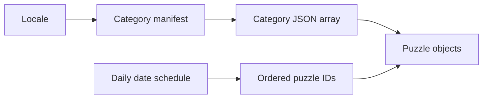

# Emoji Guess · Content and local data

There is no SQL schema in the reviewed content service. Its durable content is organized as JSON files. The iOS client uses decoded models, cache files and UserDefaults.

## Server content layout

| Structure | Contents / relationship |
| --- | --- |
| Locale directory | One content collection for a supported language |
| Manifest | Category, filename, total count and easy/medium/hard counts |
| Category file | Array of puzzle objects for one category and language |
| Puzzle | ID, emoji clue, answer, category, difficulty and hint |
| Daily schedule | Date-to-puzzle-ID lists, plus a default list |
| Infinity content | Additional puzzles combined with category content by the client |

Category prefixes and a padded numeric suffix generate new IDs. The generator scans existing IDs in that category, finds the largest matching suffix and adds one. The Swift decoder accepts either a numeric or string source ID and normalizes it to a string.

## Device storage

| Store | Keying / contents |
| --- | --- |
| Memory cache | Manifest and category arrays for the selected locale |
| Disk cache | Locale/category JSON and locale/date daily JSON |
| Category progress | Completed puzzle-ID sets and a legacy completed count |
| Infinity progress | Played-ID set; client filters these out until the pool is exhausted |
| Daily progress | Played IDs and correct count per locale and date |
| Daily reward | One completion marker per date; older locale-specific markers remain readable |
| Preferences and economy | Coin balance, sound/haptic preferences and other small local values |

The play identity combines category and puzzle ID. That avoids colliding two equal IDs from different categories. Tracking IDs also avoids treating an inserted or reordered puzzle as the same completed position.

## Consistency boundaries

Content files and the manifest are separate writes. Optional GitHub updates are another persistence step. There is no relational transaction across those operations. Progress is device-local, and the architecture described here does not include cross-device account synchronization.

[Architecture](ENGINEERING.md) · [Algorithms](ALGORITHMS.md)
