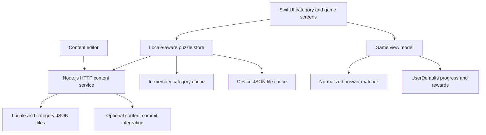

# Emoji Guess · Architecture

*Implementation notes checked against the working project on 20 November 2026. Store builds may differ as the project evolves.*

Emoji Guess uses a native SwiftUI client and a small content backend. Puzzle content is delivered remotely; progress and game state are kept locally.

| Layer | Technology | Responsibility |
| --- | --- | --- |
| Interface | Swift, SwiftUI | Categories, answer controls, hints and result screens |
| State | ObservableObject / published properties | Current puzzle, guesses, coins, streak and feedback |
| Content client | Foundation, Codable, NSLock | JSON decoding, locale-aware memory cache and disk fallback |
| Server | Node.js 20+, built-in node:http and node:fs/promises | HTTP content API and file reads/writes |
| Content storage | Locale/category JSON files | Puzzles, category manifests and daily schedules |
| Editing | Browser admin page, optional GitHub Contents API integration | Content editing and repository-backed persistence when configured |
| Local progress | UserDefaults and ID sets | Coins, completed categories, daily progress and played puzzles |
| Integrations | Firebase Analytics, Google Mobile Ads, Network, AudioToolbox | Analytics, ads, connectivity and device feedback |

The reviewed content server has no runtime package dependencies and uses Node’s HTTP server directly. It does not use Express, NestJS, Prisma or an SQL database. Firebase is used for analytics in the iOS client; that does not make Firestore the game’s database.

## Content delivery

The manifest describes available categories, filenames and puzzle counts by difficulty. Category data is loaded when needed, decoded into typed puzzles and ordered by difficulty then ID. A language change clears the in-memory manifest, category and infinity caches.

The client attempts to retrieve remote JSON, writes successful data atomically to an application-support cache, and falls back to that file when retrieval fails. Cache names include the locale and category or date. Content has to have been retrieved before it can be used as a fallback.

Daily content comes from a date-specific ID schedule, or a configured default list. The server resolves IDs against the locale’s puzzle files and returns up to ten puzzles. This is editorial scheduling, separate from Hue’s seeded daily generator.

## Content editing and persistence

An admin action writes the JSON content file and updates manifest counts. Where repository credentials are configured, the server also updates the content file through GitHub’s Contents API. This is optional file persistence, not a database transaction spanning both the filesystem and GitHub.

## Progress stays on the device

The client tracks completed puzzles by stable IDs, not only a numeric position in a list. It can migrate older count-based progress to ID sets. Daily play state is scoped by date and language; the daily reward marker is scoped by date so changing language does not make another daily reward available on the same device.

**Code landmarks:** `PuzzleStore`, `CategoryProgressStore`, `InfinityProgressStore`, `DailyProgressStore`, `DailyRewardStore`, `FuzzyMatcher`, `GameViewModel`, and the Node content server.

**Continue:** [Data layout](DATA_MODEL.md) · [Algorithms](ALGORITHMS.md) · [Product](../README.md)
