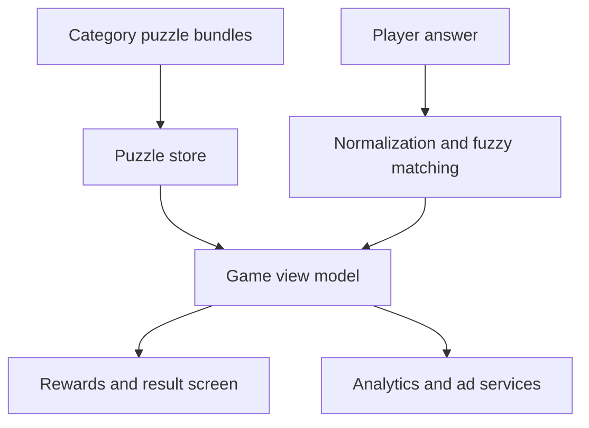

# Emoji Guess · Engineering notes

This overview describes the product’s implementation at a component level. It accompanies the [product showcase](../README.md).

## Component map

The diagram emphasizes responsibilities and data flow. Platform integrations can have their own independent lifecycle.

## Design decisions

### Fair matching for human answers

Input is normalized before comparison. The matcher handles punctuation, spaces and diacritics, then uses edit distance with answer-length-dependent tolerance for small mistakes.

### Content separated from presentation

Puzzle data lives in category bundles rather than being authored inside views. A puzzle store and model layer keep content loading separate from screen composition.

### A coordinated round lifecycle

The game view model owns puzzle progression, hints, rewards and result state. Analytics, ads and connectivity sit behind dedicated integration services.

## Stack reference

| Area | Technologies | Responsibility |
| --- | --- | --- |
| Interface | Swift, SwiftUI | Home, puzzle and result flows with responsive game state. |
| Content | JSON puzzle bundles, Foundation | Category-based content loading and puzzle models. |
| Answer evaluation | Unicode normalization, Levenshtein distance | Case/diacritic handling and limited typo tolerance. |
| Product integrations | Firebase Analytics, Google Mobile Ads | Gameplay analytics and advertising integration. |
| Device feedback | UIKit, AudioToolbox, Network | Haptics, audio feedback and connectivity observation. |

## Scope

The technology summary was checked against the application’s Swift imports, project configuration and relevant service/model implementations. Backend technologies, where listed, were checked against the associated package manifest and database schema. Store screenshots illustrate the released product; the private working project may continue evolving after release.

This documentation publishes no credentials, deployment configuration, private endpoints or application source. Product behavior and supported devices are described in the [current App Store listing](https://apps.apple.com/us/app/emoji-guess-fun-emoji-puzzle/id6762650151).
